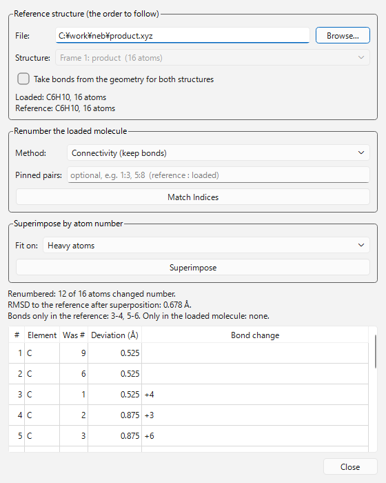

# Atom Index Mapper Plugin

[](https://github.com/HiroYokoyama/moleditpy_atom_index_mapper/actions/workflows/ci.yml)
[](https://github.com/HiroYokoyama/moleditpy_atom_index_mapper/tags)
[](https://github.com/HiroYokoyama/moleditpy_atom_index_mapper/releases)



## Overview

A NEB or IRC calculation needs its two endpoints in the same atom order. Reactant and
product optimised separately almost never are: each was built or converted on its own,
and atom 7 in one file is atom 12 in the other.

Atom Index Mapper renumbers the molecule loaded in MoleditPy into the atom order of
another structure file. It works out which atom is which through the bonds the two
structures share, so every bond that does not change in the reaction is kept. A second
button superimposes the loaded molecule onto the file atom-by-number at minimum RMSD.

## Features

- **Match Indices**: renumber the loaded molecule into the reference file's order.
  - *Connectivity* (default) pairs atoms through the largest common bonded framework,
    piece by piece, so a reaction that joins or splits fragments keeps each fragment's
    bonds. Among symmetric choices (a ring flip, a tert-butyl group) the one that
    superimposes best is used.
  - Hydrogens follow the heavy atom they sit on and are matched by geometry; a proton
    that moves from one atom to another is paired by distance.
  - *Distance* pairs each atom with the nearest one of the same element, for structures
    that already lie on top of each other (frames of one path).
  - *Pinned pairs* (`1:3, 5:8`, reference:loaded) force a choice where the geometry
    is ambiguous.
  - The report lists the bonds that exist only in the reference or only in the loaded
    molecule (the bonds the reaction forms and breaks), the RMSD after superposition
    and the deviation of every atom.
- **Change one number by hand**: select one atom in the 3D view, type its new number
  and apply. *Swap* exchanges numbers with the atom that had it; *Move* puts the atom
  there and shifts the atoms between by one.
- **Superimpose**: rotate and move the loaded molecule onto the reference, atom *i* onto
  atom *i*, by the Kabsch algorithm. Fit on all atoms, heavy atoms only, or the atoms
  selected in the editor (for example a framework that does not move during the
  reaction). The shape is never changed; the RMSD before and after is shown.
- Reads XYZ (including multi-frame trajectories, defaulting to the last frame), MOL,
  SDF, MOL2 and PDB. XYZ bonds come from the geometry; other formats use the file's
  bonds unless *Take bonds from the geometry* is ticked.
- Both actions are single undo steps. The renumbered order is what MoleditPy exports,
  saves in the project, and passes to input generators.

## Usage

1. Load one endpoint in MoleditPy with 3D coordinates.
2. Open **3D Edit > Atom Index Mapper...** and choose the other endpoint with
   **Browse...**.
3. Click **Match Indices**. The loaded molecule now has the reference's atom order.
   The two structures must contain exactly the same atoms (same count of every element);
   otherwise the difference is shown and nothing changes. Fix any single number by hand
   if needed.
4. Optionally click **Superimpose** to bring it into the reference's frame, which keeps
   the interpolated NEB path short.
5. Export the structure (for example **File > Export > XYZ**) for the calculation.

## Requirements

Only what MoleditPy already provides: RDKit, numpy and PySide6. SciPy is used for the
assignment step when it is installed, and a built-in implementation otherwise.

## Development and testing

```bash
python -m pytest tests/ -v
ruff format atom_index_mapper tests && ruff check atom_index_mapper tests
```

The mapping logic in `atom_index_mapper/core.py` has no Qt dependency and is tested on
real RDKit molecules, including a Diels-Alder pair and a proton transfer. The dialog is
tested with a real Qt and a fake host context, and `tests/test_api.py` checks every host
API call against the MoleditPy source when it is checked out beside this repository.

## Licensing scope

First-party code is LGPL-3.0-or-later. See [LICENSE](LICENSE), [COPYING](COPYING) and
[dependency/provenance terms](LICENSING.md). Third-party components retain their own
terms.
